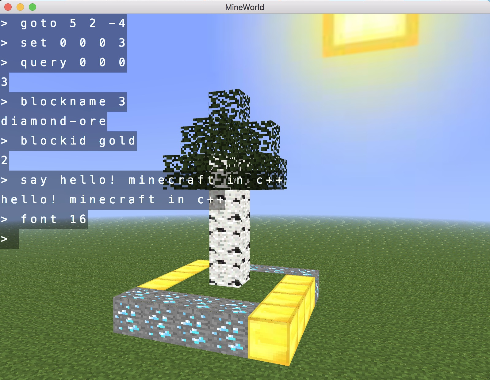

# MineWorld

[English](README-en.md)

## 简介

a simple minecraft clone, written in c++

## 操作

* W/A/S/D : 前进/左/后退/右
* Esc : 按一下暂停，再按继续
* 鼠标左键：破坏方块
* 鼠标右键：放置方块
* T : 敲指令（见**指令**）
* 键盘左右键：切换手里拿的方块

## 指令

* 放置方块

```
set x y z B // 在 (x, y, z) 处放置 ID 为 B 的方块
```

* 查询方块ID

```
query x y z // 返回 (x, y, z) 处的方块 ID
```

* 根据方块名查询ID

```
blockid s // 返回名字为 s 的方块 ID
```

* 查询方块名

```
blockname id // 返回 ID 为 id 的方块名
```

* 列出所有方块

```
blocklist // 返回方块列表
```

* 传送

```
goto x y z // 传送至 (x, y, z)
```

* 说话

```
say words // 在终端打印 words
```

* 调整字体大小

```
font S // 调整字体大小为 S 个 pixel
```

* 清屏

```
clear // 清空屏幕
```

* 退出游戏

```
exit // 退出游戏
```

## 截图



## 编译

### 前置条件

- CMake 3.15+
- Git（用于克隆仓库和子模块）
- 支持 C++17 的编译器

```bash
git clone --recursive https://github.com/yuchenxi2000/mineworld.git
cd mineworld
```

### Windows

两种方式任选其一。

#### 方式一：MSYS2 UCRT64

1. 安装 [MSYS2](https://www.msys2.org/)，开始菜单搜索msys2，点击运行打开终端

2. 安装编译工具和 GLEW：

   ```bash
   pacman -S mingw-w64-ucrt-x86_64-gcc mingw-w64-ucrt-x86_64-cmake mingw-w64-ucrt-x86_64-make mingw-w64-ucrt-x86_64-glew
   ```

3. 编译：

   ```bash
   cmake -S . -B build_msys2 -G "MinGW Makefiles" -DCMAKE_BUILD_TYPE=Release
   cmake --build build_msys2 --parallel
   ```

4. 运行：

   ```bash
   cd res && ../build_msys2/mineworld.exe
   ```

#### 方式二：Visual Studio Build Tools

1. 安装 [Visual Studio Build Tools](https://visualstudio.microsoft.com/zh-hans/downloads/)（在「所有下载」中找「Visual Studio 生成工具」），勾选「使用 C++ 的桌面开发」

2. 下载 [GLEW 官方 Windows 预编译包](https://github.com/nigels-com/glew/releases/tag/glew-2.3.1)，将其中的 `glew-2.3.1` 目录完整解压到 `deps/`。确认存在以下文件：

   ```text
   deps/glew-2.3.1/include/GL/glew.h
   deps/glew-2.3.1/lib/Release/x64/glew32s.lib
   ```

   只解压 `bin/` 和 `lib/` 不够；MSVC 不能使用 MSYS2 的标准库头文件或 `.a` 库。

3. 在项目根目录打开 **PowerShell**，使用本机安装的 Visual Studio 生成器编译 Release：

   ```powershell
   $glewRoot = Join-Path (Get-Location) "deps/glew-2.3.1"
   cmake -S . -B build_vs -G "Visual Studio 18 2026" "-DGLEW_ROOT=$glewRoot"
   cmake --build build_vs --config Release --parallel
   ```

   > VS 2022 请将生成器改为 `"Visual Studio 17 2022"`。同一个构建目录不能混用不同生成器，MSVC 和 MSYS2 分别使用 `build_vs` 与 `build_msys2`。

   > CMake 会严格使用 `GLEW_ROOT` 中的 MSVC 依赖，避免误选 PATH 中的 MSYS2 GLEW；无需从系统 PATH 删除 MSYS2。旧缓存的项目需先重新执行上面的配置命令。

   > 默认静态链接 GLEW，并统一使用静态 MSVC 运行库。设置 `-DGLEW_SHARED=ON` 时改用 DLL，构建后会自动将 `glew32.dll` 复制到可执行文件旁。

4. 运行：

   ```powershell
   .\build_vs\Release\mineworld.exe
   ```

### macOS

```bash
brew install glew
mkdir build && cd build
cmake ..
make
cd ../res && ../build/mineworld
```

### Linux

```bash
apt install libglew-dev   # 或对应包管理器
mkdir build && cd build
cmake ..
make
cd ../res && ../build/mineworld
```

### 回归测试

在配置 CMake 时加上 `-DBUILD_TESTING=ON`，编译后运行：

```bash
ctest --test-dir build --output-on-failure
```

Visual Studio 等多配置生成器需加上 `-C Release`，与编译配置一致。默认回归测试无需打开窗口；额外配置 `-DMINEWORLD_GL_TESTS=ON` 可以启用隐藏窗口的 OpenGL 测试，需要可用的桌面图形环境。

macOS 应用包、Universal Binary 双架构验证及完整运行命令见 [tests/README.md](tests/README.md)。

### 重要提示

程序优先读取当前目录的 `config.json`，也会在可执行文件附近的 `res/` 目录及 macOS 应用包的 `Resources/` 中寻找资源。保持 `res/` 中的配置、材质和着色器目录完整。

## 制作自己的材质包

因为我懒，材质包是 minecraft 的材质包借过来的。

游戏启动时会寻找 config.json，从里面读入设置。然后在 config.json 里指定的 block file 里读入 block 信息（加载材质包）。

如果想制作材质包，可以参考我写的 block.json。

## 许可

MIT License. 详见 [LICENSE.txt](LICENSE.txt)。

